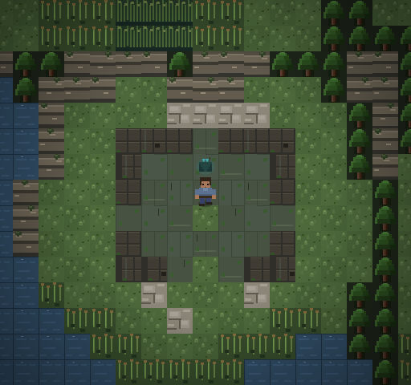
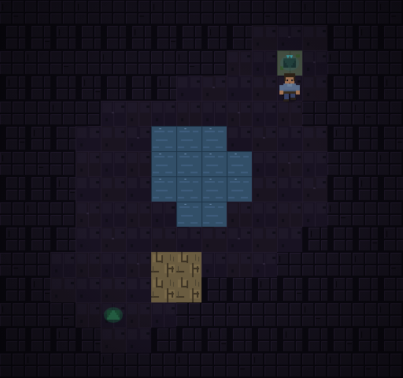
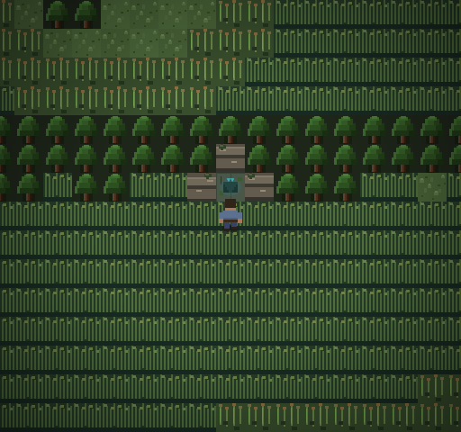

# The Broken Rise and Fen Caverns

Chunk **(3,-1)** was genuinely unplaced. It now contains a reed-fringed wooded
rise above the reservoir, with roofless, broken masonry and a descending stair.
The ruin's origin is unspecified. Names and presentation remain revisable.

The four adjacent chunks are existing scenery, so the rise is reached through
an optional two-way cave from the northern Great Fen. No adjacent scenery is
opened, and all four surface edges remain physically blocked by water, hills
or woodland. This deliberately preserves the starting region, ferry, Rise
ambush and sealed southern bank. The ruin is a destination, not a progression
shortcut.

## Walkthrough

Coordinates below are zero-based local tiles; world chunks use atlas coordinates.

1. Reach **Willow Basin, chunk (-3,-14)**. Walk north from local **(7,3)** onto
   the dark stair at **(7,2)** beside the exposed rock face.
2. Explore **Root Cleft**, then descend through the southern stair.
3. Follow either dry side of the pool in **Still Water**, continuing south.
4. Traverse **Broken Descent** and take the southern upward stair.
5. Emerge at **The Broken Rise, chunk (3,-1)** beside the ruin's stair at **(8,4)**.
   Explore the ruin and the bank; return by the same cave system.
6. Save/load in each chamber and at the rise. Try continuous and Legacy Regional
   Fallback presentation; arrivals should remain walkable and never bounce back.
7. Debug warp to any of the three named cave destinations and leave normally.

These are quiet exploration maps. No new enemies, treasure, NPCs, quest stages,
rewards or mutable state have been introduced. Ordinary encounters elsewhere
in the northern fen retain their existing assignments.

## Geography and passages

| Map | Role | Entrance/exit cells | Safe arrivals |
|---|---|---|---|
| `MAINLAND_CN3RN14_MAP` | Northern cave opening | (7,2) | (7,3), facing down |
| `FEN_CAVE_ROOTS_MAP` | Root cleft, crooked dry passages | (10,2), (4,12) | (10,3) down; (4,11) up |
| `FEN_CAVE_POOL_MAP` | Underground pool with two dry routes | (11,2), (4,12) | (11,3) down; (4,11) up |
| `FEN_CAVE_DESCENT_MAP` | Broken masonry and damp lower pocket | (11,2), (7,12) | (11,3) down; (7,11) up |
| `FEN_RUIN_RISE_MAP` | Wooded ruin above the reservoir | (8,4) | (8,5), facing down |

The cave is compressed game geography. Its pool does not reroute the reservoir
or imply a new engineered canal connection. Water remains impassable.

Exactly **four existing cells** change in `MAINLAND_CN3RN14_MAP`:

| Local tile | Before | After |
|---|---|---|
| (7,1) | TREE (3) | HILLS (119) |
| (6,2) | TREE (3) | HILLS (119) |
| (8,2) | TREE (3) | HILLS (119) |
| (7,2) | SATURATED_PEAT (127) | RUIN_STAIRS_DOWN (79) |

The former entrance at (3,-9) has been fully restored to its original three
trees and grass. This relocation changes eight cells relative to the previous
cave implementation; the net addition remains four cells against pre-cave terrain.
The three rock-face cells remain blocking; the entrance remains walkable.
`grid-deltas.json` records the exact change. Every other existing regional grid,
metadata field, camera setting, seam and tile definition is preserved.

## Implementation

- The new map fragment owns one regional definition and three discrete maps.
- All terrain and graphics reuse existing tile IDs. No image assets enter the game.
- Eight reciprocal point passages use the shared atomic `transitionToLocation()`
  authority. `fenCaverns.tryDoor()` uses the active physical map and canonical
  regional coordinates. It performs no whole-world scan or cross-seam activation.
- Each landing is off its reciprocal trigger. Three neutral debug destinations
  use the same ordinary exits. Existing save schema and SAVE_VERSION **5** suffice.
- No surface `EDGE_TRANSITIONS` are added: the rise has no walkable border.

## Verification

Suite 348 walks the whole northern-mouth → ruin → northern-mouth route in both
movement modes, with save/load in every destination, exact restoration and no
bounce. It also checks all new floor components, ordinary exits after debug
warp, canonical position, no gameplay-state mutation, northern approach
reachability and early-region separation.

Automated Chromium: **559 checks**, native 512×480 and 2× 1024×960; all eight
passages in both directions/modes, collision-safe walked routes, saves and
returns. Screenshots are real Canvas output. The ruin, northern opening and
all three chambers were visually inspected. This is automated browser testing and
screenshot review, not a human gameplay playthrough.

Validation has zero errors and the six existing warnings. The transition audit
has 1267 maps and 487 fixed-destination checks (four maps and eight passages
added); the 2072 edge segments, eight preserved-coordinate checks and 42 house
doors are unchanged. Read-only comparison passes after explicit regeneration.

Regional totals: **1059 chunks, 489 placement-enabled, 570 scenery**; the sealed
reserve remains included in the placement-enabled count. World bounds and
encounter-enabled total (469) are unchanged. Map catalogue: **1267** entries.

## Artifacts and historical checks

- Regional fingerprints regenerated: one new rise fingerprint, the relocated
  northern-mouth fingerprint; the former mouth fingerprint is restored. Prior Rocky Beach fingerprints are retained.
- `test/transition-audit-output.json` regenerated through its existing generator
  for the four new maps/eight point passages and the now-filled coordinate.
- Atlas Markdown, inventory and SVG regenerated from live definitions; production
  overview regenerated through the actual tile renderer in the browser review.
- Explicit old map/chunk totals gain four/one respectively. The surface graph
  gains an isolated node; adding the real cave connection joins it to the fen.
- Historical geography tests reverse only these four reviewed cells and remove
  the one added regional chunk on detached snapshots. Old assertions remain
  strict. No live grids are mutated for validation or rendering.
- Existing Rocky Beach and wilderness-dream work is preserved. Nothing is staged,
  committed, merged or pushed; this task remains on main at `286911f`.

## Screenshots

## Final results and file inventory

- Full regression: **284 tests, 284 passed, 0 failed**.
- **47 JavaScript syntax checks** pass, including the historical test snapshots.
- **559 automated Chromium checks** pass at native/2× scale.
- Validation: **0 errors, 6 existing warnings**; SAVE_VERSION remains **5**.
- All **1059** regional fingerprints verify. Transition artifact matches in
  read-only verification; whitespace and conflict-marker checks pass.
- The initial full run identified old totals/border expectations and an old
  restriction on driftwood reuse. Those assertions now describe the one added
  region and explicitly allow timber only in Root Cleft. The final full run
  passes with all substantive checks retained.

[Exact files changed by this task](files-changed.json), including generated
artifacts and screenshots. Production changes are the new map fragment and
passage controller, four cells in `mainland-maps.js`, catalogue/load-order wiring,
map titles/content keys, movement dispatch and three debug destinations.
Most test-file changes update explicit world totals, while suite 348 supplies
navigation/state coverage and the history helper preserves older baselines.

Final Git state: **main**, HEAD **286911fc92405fadf9fec2c8c9c99db8667122e6**,
unstaged modifications/untracked files, no staged changes. Nothing committed,
merged or pushed. Existing unrelated work is retained.

## Northern entrance relocation

The northern mouth is now in Willow Basin at world chunk **(-3,-14)**,
local stair **(7,2)**. Returning from Root Cleft lands at **(7,3)** facing south
(pixel centre **240,112**). Walk north from there to enter. The former mouth
at **(3,-9)** has no remaining trigger; its grass and three trees are restored.
The cave interiors, ruined rise, encounters, camera policies and surface seams
are unchanged. The net terrain changes above now describe the relocated mouth.

The relocation was checked with the same 559 automated browser checks at both
scales and in both movement modes, plus screenshot inspection of the new mouth.
This was automated input testing, not a manual gameplay session. For playtesting,
walk north into the new stair, traverse to the ruin, save/load, and return;
also visit the former mouth to confirm it behaves as ordinary grass.

[Files changed by this relocation only](relocation-files.json).

Relocation verification: **284/284 regression suites pass**, all **7 changed
JavaScript files** pass syntax checks, validation reports **0 errors / 6 existing
warnings**, all **1059 fingerprints** verify, and the regenerated transition
artifact matches. SAVE_VERSION remains **5**. Whitespace checks pass.
