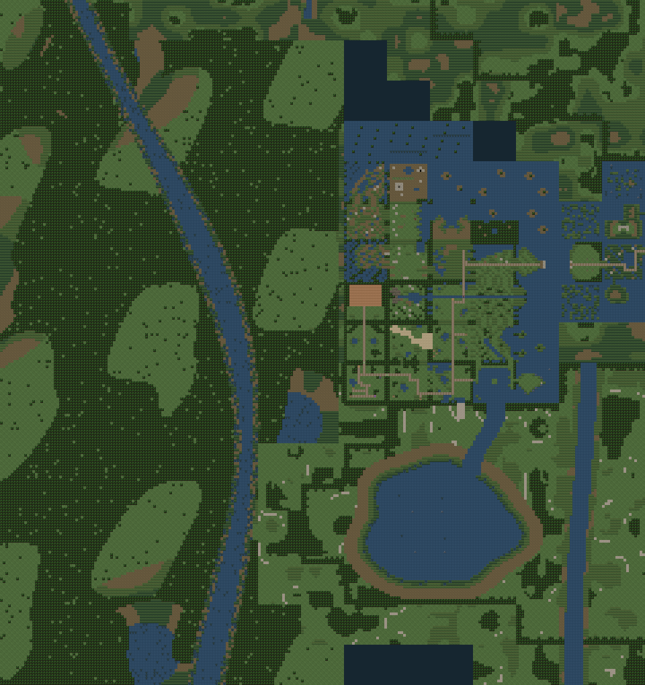

# Wetwoods and Thornmere terrain review

This pass follows the supplied B3 western-waterway composition while preserving actual game coordinates, ordinary gameplay, camera policies and the closed southern starting-area route. The final authored limits remain column −8 west and row +12 south, within the clarified +13 limit.



## Footprint and preservation

- 114 new **scenery-only** Wetwoods chunks; no entrances, encounters or save destinations.
- 28 existing grids / 4,874 cells changed: eight inaccessible western framing grids and 20 grids in the already-sealed southern reserve. [Exact cell and metadata deltas](grid-deltas.json).
- All other 916 old regional grids are unchanged, including all 454 ordinary-play/protected grids. Existing tile definitions, camera metadata, content keys, coordinates and story infrastructure are unchanged.
- Thornmere is connected to the old northern shallows through a narrow water reach. Open water is impassable; its irregular reed shore uses existing assets. Four fully submerged reserve chunks now correctly have scenery-only placement/encounter/save permissions. No previously closed physical edge is opened.
- 1,058 regional chunks: 477 placement-enabled, 581 scenery-only, 458 encounter-enabled. The placement-enabled count includes sealed reserve shores, not just ordinarily reachable terrain.
- SAVE_VERSION remains 5. Ordinary saves are unaffected. A debug-only save standing on a newly submerged reserve tile remains subject to atomic invalid-placement rejection; no silent relocation or migration is introduced.

## Evidence and provenance

[Browser result](browser-results.json) records **155 successful automated checks, 49 captures and zero browser errors**, at 512×480 and 1024×960. It includes keyboard seam/river crossings, save/load, the exact four early camera clamps, the intact Thornmere water barrier, Zolom approach and Calwick/Drenwick rendering. The Wetwoods/open-water captures are explicitly **read-only tile-painter views**: those scenery maps cannot be entered by the player, and no gameplay position is spoofed to render them. Native and 2× captures were visually inspected. This is not a claim of a human gameplay walkthrough.

- [Stream, native](wetwoods-stream-1x.png) / [2×](wetwoods-stream-2x.png)
- [Woodland clearing, native](wetwoods-clearing-1x.png) / [2×](wetwoods-clearing-2x.png)
- [Thornmere west bank, native](thornmere-west-bank-1x.png) / [2×](thornmere-west-bank-2x.png)
- [Thornmere south shore, native](thornmere-south-shore-1x.png) / [2×](thornmere-south-shore-2x.png)

The [live atlas](../../../OVERWORLD_ATLAS.md), [vector overview](../regional-geography/overview.svg), [production tile overview](../regional-geography/production-overview.png), [inventory](../regional-geography/inventory.json), regional fingerprints and transition artifact are regenerated because their authoritative terrain/catalogue inputs changed. The production PNG comes from the game's `drawMapTiles` in Chrome; the local western crop is pixel-identical to that overview, not a generated illustration. The B3 reference PNG/HTML are unchanged.

The transition artifact preserves the earlier uncommitted Mornay increment (23 additional interiors, 442 fixed destinations total). This geography pass changes regional terrain/metadata and reserved shoreline seams only. The original mainland `grid-deltas.json` and earlier screenshots remain historical evidence; the delta linked above is the new increment.

## Verification contract

Suite 322 compares exact pre-pass reachable tile sets, not just destination maps: **2,792 early**, **42,498 ferry-side** and **30,820 onward** tiles remain identical with the appropriate Rise cut. It pins protected grids, unchanged tile definitions and bounds; checks all new scenery placement rejections are atomic; and verifies the connected impassable Thornmere basin and varied shoreline. Suite 317 retains reserved shoreline connectivity and return-path checks; 318 checks all remaining walkable cells at five camera positions each; 320 retains exact early framing and water closure assertions. The continuous-seam suite exercises the real movement controllers across every surviving seam in both modes.

Historical totals are adjusted for 114 new chunks and four submerged reserve chunks. Reused terrain is explicitly allowed in Wetwoods/Thornmere, with no generic relaxation of region ownership. All old-town, combat, story, placement and collision assertions are retained. [Validation](validation.json) reports zero errors and the same six pre-existing warnings. Final regression/syntax/audit results are recorded in [verification.json](verification.json).

## Short manual checklist

1. Walk west against Northern Road and Blocked Path: retain their old camera edges and closed boundaries.
2. Walk south in Eastern Reaches and Thornmere Fen: retain their old framing. In MAP3, try the old opening at local columns 9–12 / rows 13–14; water must block departure.
3. Inspect Wetwoods in the atlas or read-only QA view: stream at chunk (−3,5), clearing at (−5,5), dense woodland at (−7,9). These are deliberately inaccessible scenery, not debug destinations.
4. For authoring review only, debug-warp to safe footing in `MAINLAND_C0R8_MAP` (west shore), `MAINLAND_C4R8_MAP` (east shore), or `MAINLAND_C2R10_MAP` (south shore). Inspect the bank, walk around collision, cross a surviving reserve seam, save/load. This reserve remains sealed; use debug warp to leave as before.
5. Check ordinary Calwick/Drenwick travel, the ferry and the Rise ambush/camp requirements. None should gain a new route through Wetwoods or the lake reserve.

No staging, commit, merge or push was performed. The primary checkout remains on `main` at `59e7851`; pre-existing Mornay implementation and its untracked test remain preserved. The following inventory identifies this terrain pass's files, including shared aggregate tests whose pre-existing Mornay edits were retained.

## Files in this terrain pass

```text
Art/qa/regional-geography/inventory.json
Art/qa/regional-geography/overview.svg
Art/qa/regional-geography/production-overview.png
Art/qa/wetwoods-thornmere/README.md
Art/qa/wetwoods-thornmere/browser-results.json
Art/qa/wetwoods-thornmere/grid-deltas.json
Art/qa/wetwoods-thornmere/thornmere-south-shore-1x.png
Art/qa/wetwoods-thornmere/thornmere-south-shore-2x.png
Art/qa/wetwoods-thornmere/thornmere-west-bank-1x.png
Art/qa/wetwoods-thornmere/thornmere-west-bank-2x.png
Art/qa/wetwoods-thornmere/validation.json
Art/qa/wetwoods-thornmere/verification.json
Art/qa/wetwoods-thornmere/western-overview.png
Art/qa/wetwoods-thornmere/wetwoods-clearing-1x.png
Art/qa/wetwoods-thornmere/wetwoods-clearing-2x.png
Art/qa/wetwoods-thornmere/wetwoods-stream-1x.png
Art/qa/wetwoods-thornmere/wetwoods-stream-2x.png
OVERWORLD_ATLAS.md
PROJECT_STATUS.md
REGIONAL_GEOGRAPHY_PLAN.md
content/maps/mainland-maps.js
test/cases/100-east-causeway.test.js
test/cases/101-west-outfall-canal-tunnel.test.js
test/cases/102-north-basin-drowned-rim.test.js
test/cases/103-north-basin-mirewood.test.js
test/cases/104-eastern-reaches-abandoned-farmhouse.test.js
test/cases/175-eastern-fens-exploration.test.js
test/cases/176-eastern-fens-envelope.test.js
test/cases/177-eastern-fens-western-pockets.test.js
test/cases/200-eastern-fens-mornay-encounter-content.test.js
test/cases/201-travellers-rise-campsite.test.js
test/cases/207-travellers-rise-campfire-night.test.js
test/cases/209-eastern-fens-new-terrain-tiles.test.js
test/cases/218-mornay-exterior-topology.test.js
test/cases/301-mornay-manifest.test.js
test/cases/318-mainland-water-camera.test.js
test/cases/322-wetwoods-thornmere.test.js
test/cases/58-regional-content-split.test.js
test/cases/72-continuous-seams.test.js
test/cases/73-continuous-neighbour-content.test.js
test/cases/76-geographic-encounters.test.js
test/cases/77-map3-fen-seam-pilot.test.js
test/cases/78-verdant-vale-legacy-home.test.js
test/cases/83-map3n2-northbasin-seam-closure.test.js
test/cases/84-canonical-regional-position.test.js
test/cases/85-canonical-consumers-part2.test.js
test/cases/86-regional-chunk-catalog.test.js
test/cases/88-continuous-regional-production-default.test.js
test/cases/89-west-outfall-scenery-chunk.test.js
test/cases/90-north-basin-open-reservoir.test.js
test/cases/91-north-basin-open-reservoir-east.test.js
test/cases/92-north-basin-eastern-woods.test.js
test/cases/93-north-basin-open-reservoir-far-east.test.js
test/cases/94-north-basin-east-shore-reservoir.test.js
test/cases/95-north-basin-eastern-road.test.js
test/cases/96-eastern-canal-banks.test.js
test/cases/97-northern-thornmere-fen.test.js
test/cases/98-thornmere-upper-shallows-scenery.test.js
test/cases/99-thornmere-canal-head.test.js
test/fixtures/regional-grid-fingerprints.js
test/fixtures/wetwoods-invariants.json
test/regional-atlas.js
test/regional-geography-browser.js
test/transition-audit-output.json
world-transitions.js
```

Final results: **258/258 regression suites**, 52 JavaScript syntax checks, zero validator errors / six unchanged warnings, all 1,058 fingerprints matching, transition artifact matching, and `git diff --check` clean. The previously completed Mornay baseline passed 257/257; this pass adds suite 322. All work remains unstaged and uncommitted.
