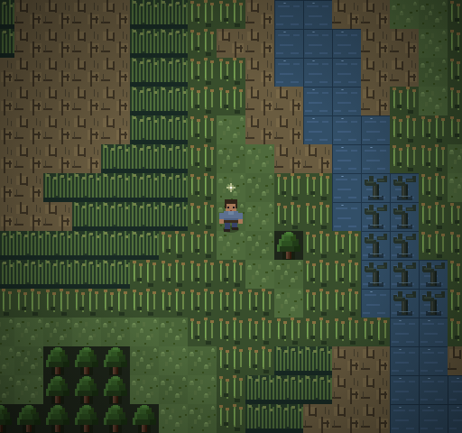
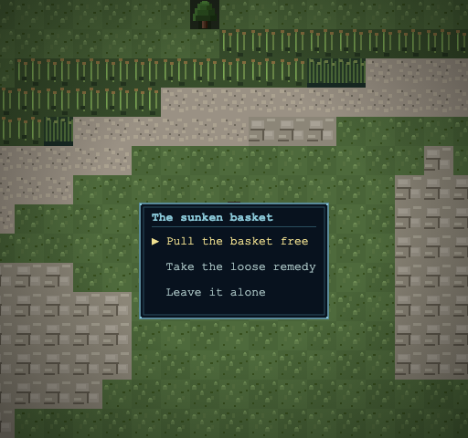
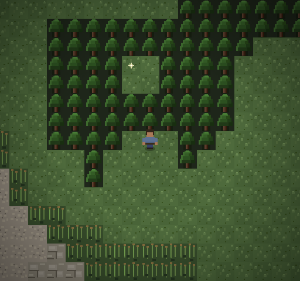

# Wilderness discoveries

Ten one-time sparkles add small finds and optional encounters to the expanded
Great Fen and eastern mainland. Names and flavour are revisable content.
No new quests, NPCs, enemy templates, equipment tiers or save fields are added.

## Sites and choices

Chunk and local tile coordinates are zero-based. Walk onto a sparkle and press
Space/Enter to examine it; simply walking over one does not consume it.

| Discovery | World chunk | Local tile | Result |
|---|---|---|---|
| Split satchel in grass | (-2,-6) | (10,9) | Potion |
| Cutter's boot-wrap | (5,-10) | (10,7) | Reed Remedy |
| Wicker bottle-case | (10,-7) | (8,4) | Elixir |
| Washed-up river parcel | (22,4) | (5,9) | Potion |
| Carter's axle bag | (25,6) | (13,8) | Reed Remedy |
| Field flask in grass | (26,1) | (12,6) | Elixir |
| Sunken basket | (-4,-9) | (6,10) | Fight a Reedbinder for an Elixir; take a loose Reed Remedy without fighting; or leave |
| Trembling bundle | (9,-5) | (10,6) | Fight two Bell-Throated Toads for an Elixir, or leave |
| Fallen timber | (23,5) | (11,11) | Fight two Hollowreed Chokers for an Elixir; take an outer Potion without fighting; or leave |
| Hidden woodland cache | (24,2) | (4,4) | Void Shard |

Leaving a choice alone changes nothing. Taking the smaller safe reward resolves
that site; it cannot also grant the risky reward. Victory resolves the site and
grants its cache once, in addition to the enemies' ordinary shared-engine battle
rewards. Escape and defeat leave it available for a later attempt. Existing enemy
mechanics, graphics and ordinary random encounter assignments are unchanged.

The secret is reached from local **(5,8)** in chunk **(24,2)**. Examine the glint
there for bootmarks entering hanging branches. Walk north through apparently solid
trees at **(5,7)** and **(5,6)** into a tiny clearing. Return through the same gap.
The cache cannot be examined from outside. The clue remains repeatable.

## Research and implementation

- `tryExamineWorldItem()` and the field Potion supply the examine-only pickup
  pattern; `PICKUP_REGISTRY` and collected pickup IDs supply one-time persistence.
- The Mire Toad spawning site supplies the `scriptedInspect` pattern: the generic
  grant path must skip it, while its own handler owns choices and completion.
- Mornay removal contracts and The Struck Entry supply the authenticated
  `scriptedPartyEncounters` formation lifecycle, including solo/party support,
  exact-origin checks, escape, defeat and rejection of forged/repeated receipts.
- Existing `WORLD_HOLLOW` (73) supplies walk-through tree scenery. There is no
  collision exception, special warp, new tile type or camera change.
- `MAP_FEATURES` supplies the repeatable sparkling bootmark clue.
- LORE.md's freshwater fens, drought, small-scale reed/peat work and timber/cart
  economy inform the descriptions. No unresolved ruin origin or plot is defined.

`content/wilderness-discoveries.js` owns descriptions, placements, rewards and
formations. Ten authored mainland definitions bind their item sets through the
existing catalogue pipeline. `wilderness-discoveries.js` handles active-map-only
choices using canonical regional coordinates. Only the shared authenticated combat
finalizer may award the risky branch. Safe choices and ordinary pickups use the
existing `grantItem()` authority. Completion is existing `.picked` state, saved by
stable pickup IDs; **SAVE_VERSION remains 5**. Old saves leave new sites available.

## Exact terrain scope and artifacts

Only six cells of `MAINLAND_C24R2_MAP` change:

- (4,4), (5,4), (4,5), (5,5): TREE 3 → GRASS 0.
- (5,6), (5,7): TREE 3 → WORLD_HOLLOW 73 (still drawn as trees).

[Exact cell deltas](grid-deltas.json) and [ten item-set bindings](item-sets.json).
Those ten maps also update their descriptive notes. All other grids and all
seams, cameras, region bounds and encounter pools remain unchanged. Flood tests
prove the only newly reachable tiles are the six cells of this dead-end pocket;
early, ferry, Rise and sealed southern progression boundaries remain protected.

Regional/map totals remain 1059 chunks / 1267 maps. Fingerprints are regenerated
for the single changed grid. Atlas Markdown, inventory/SVG and actual-renderer
production overview are refreshed through existing tooling. The transition audit generator reproduces the existing artifact unchanged;
read-only comparison passes because no transitions or map totals change.
Historical tests reverse only the reviewed six cells and ten item-set/notes
additions on detached snapshots; prior substantive baselines are preserved.

## Verification and playtest checklist

Suite 349 covers all item pickups; all three optional encounters with solo and
party combat; safe branches; leave, escape and defeat; stale callbacks; one-time
rewards; saves and old saves; hidden-tree movement/return in both modes; exact
terrain bounds; and early-region separation. Existing historical geography and
cave suites are retained.

Browser review uses actual Canvas output and keyboard events for examining,
choices and movement at 512×480 and 1024×960 in continuous and legacy views.
Battle resolution additionally drives the shared command controller. This is
automated browser testing and screenshot inspection, not a human playthrough.

For a short manual walkthrough:

1. Visit the satchel at (-2,-6), examine it, and save/load; confirm it stays gone.
2. At (-4,-9), first leave the basket alone, then take the safe remedy. On another
   save, fight the Reedbinder and confirm its larger reward is awarded once.
3. Inspect both other encounter choices; retreat from one fight and retry.
4. Follow the bootmarks at (24,2), walk through the tree scenery, collect the
   hidden cache, save/load inside, and walk back out.
5. Inspect the choices at native and 2× scale, then repeat with Legacy Regional
   Fallback. All three enemy groups use their existing battle graphics.

[Exact files changed in this pass](files-changed.json).

## Verification results

- Final full regression: **285 tests, 285 passed, 0 failed**.

- Focused suite 349 and existing cave/geography/persistence checks pass.
- **543 automated Chromium checks** pass at native and 2× scales, in both modes.
  Pixel comparison confirms that concealed entrance foliage matches a neighbouring
  solid TREE. Choice menus, supply sparkles, secret approach/cache and battle
  graphics were inspected in the captured Canvas output.
- **13 changed/new JavaScript files** pass `node --check`.
- `validateGameData()`: **0 errors, 6 pre-existing warnings**; SAVE_VERSION **5**.
- All **1059 regional fingerprints** match; transition audit matches read-only.
- The initial full regression found only the old pickup-count snapshot. It is
  now 64 (formerly 54), with uniqueness, reorder/save and rejection assertions
  retained. No runtime failure or balance change was needed for that correction.

Work remains unstaged and uncommitted on main at `286911f`. No merges or pushes.
Prior Rocky Beach, wilderness dreams and Fen Caverns work is preserved.
